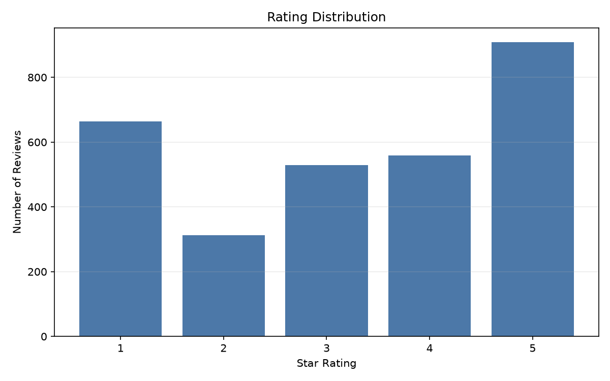
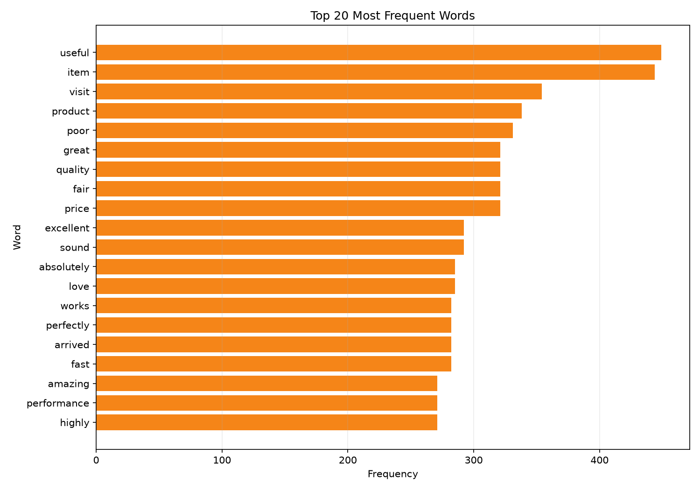
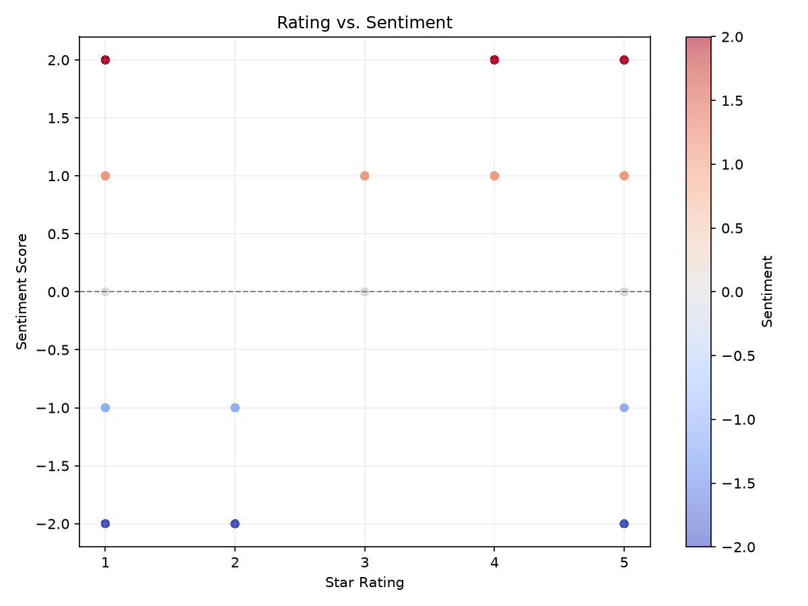
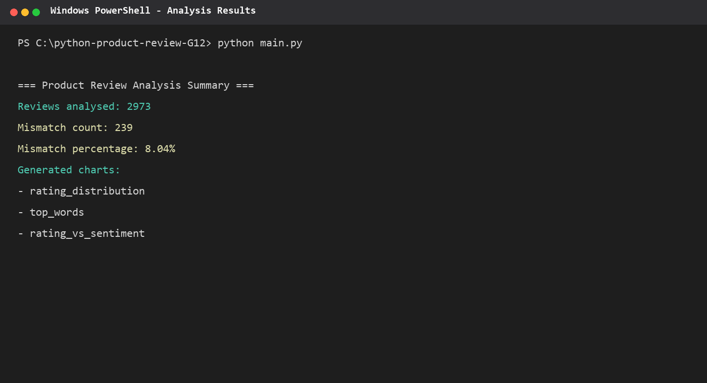
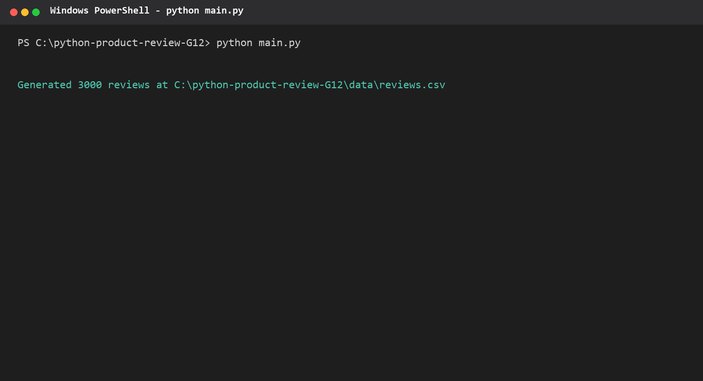

# Product Review Text & Rating Analyzer - FM1205


## Problem statement

Online sellers receive thousands of product reviews but cannot read them all. This project cleans review text, identifies frequent words, compares lexicon-based sentiment with star ratings, and highlights mismatches.

## Repository

This project will be published under the student's own GitHub account.

## Dataset

The application automatically generates 3,000 synthetic reviews in `data/reviews.csv`. Fields include product, category, rating, date, and review text. Synthetic messy values include mixed date formats, URLs, mentions, emojis, and repeated letters.

| Column | Description |
|---|---|
| `product` | Product name |
| `category` | Product category |
| `rating` | Star rating from 1 to 5 |
| `date` | Review date in a mixed format |
| `review_text` | Raw review text containing messy values |

## Project structure

```text
python-product-review-G12/
├── data/
├── src/
│   ├── cleaning.py
│   ├── analysis.py
│   └── visuals.py
├── outputs/
├── screenshots/
├── main.py
├── requirements.txt
└── README.md
```

## How to run

```powershell
cd C:\python-product-review-G12
python -m pip install -r requirements.txt
python main.py
```

The program creates `data/reviews.csv`, `outputs/cleaned_reviews.csv`, and three PNG charts in `outputs/`.

## Features

- Regex removal of URLs, @mentions, and emojis
- Normalisation of repeated letters
- Word tokenisation and stop-word removal
- `Counter` word-frequency analysis
- NumPy/Pandas sentiment and mismatch analysis
- Rating distribution, top-word, and rating-versus-sentiment charts
- Detection of rating/sentiment mismatches
- Export of cleaned records to CSV

## Visualisations







## Execution screenshots





## Verified execution results

- Synthetic reviews generated: **3,000**
- Valid reviews analysed: **2,973**
- Rating/sentiment mismatches: **239**
- Mismatch percentage: **8.04%**
- Visualizations generated: **3**

## Testing

Run the unit tests:

```powershell
python -m unittest discover -s tests -v
```

## Student

- FM1205

## Resume bullet

Developed a review-mining tool that cleans 3,000 reviews with regex and scores sentiment using Python data structures and Pandas.
